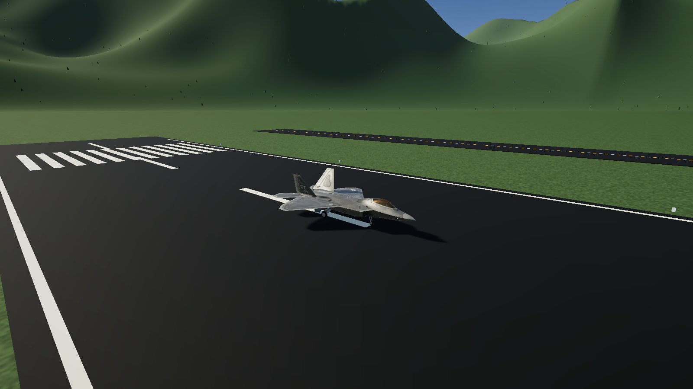
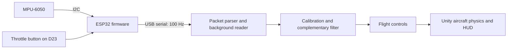
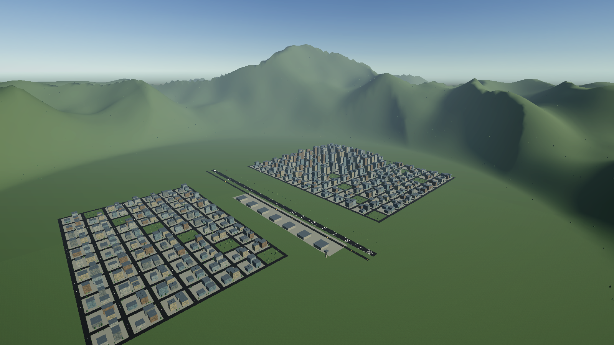

# Motion-Controlled Flight Simulator

A Unity flight simulator controlled by a handheld ESP32, an MPU-6050 motion sensor, and a breadboard throttle button. Tilt the controller to pitch and roll the aircraft; hold the button to accelerate.

Built with **C#**, **Unity**, **C++/Arduino**, **ESP32**, **I2C**, and **USB serial**.



*Aircraft model by [bohmerang](https://sketchfab.com/bohmerang), licensed under [CC BY-NC-SA 4.0](https://creativecommons.org/licenses/by-nc-sa/4.0/). See [asset attribution](Assets/Models/F22/ATTRIBUTION.md).*

## Features

- F-22 aircraft with tunable flight physics, runway takeoff, landing gear, brakes, and reset controls.
- A 3 km runway, airport, city buildings, trees, and surrounding mountain terrain.
- 100 Hz sensor and button packets over a USB connection at 115200 baud.
- Gyro-bias calibration and complementary filtering for pitch/roll, with a dead zone and adjustable smoothing.
- A debounced physical throttle button: hold for full throttle, release for idle.
- Packet checksums, stale-data detection, automatic reconnect, and idle throttle/braking when motion input is unavailable.
- A keyboard/mouse mode for trying the simulation without hardware.

This is a game and hardware-integration prototype with approximate flight physics. The current USB serial adapter supports the **Windows Unity Editor and Windows player**.

## Try the simulation

1. Clone or download this repository.
2. In Unity Hub, add the repository root as a project and open it with **Unity 6000.6.0f1**. Let Unity restore the packages listed in `Packages/manifest.json`.
3. Choose **Flight Lab > Open Raptor Valley**, or open `Assets/FlightLab/RaptorValley/RaptorValley.unity`.
4. Press **Play** and focus the Game view.
5. **Without a controller:** press **M** to switch to keyboard/mouse mode. Hold left mouse for throttle, then use W/S and A/D to pitch and roll.
6. **With a controller:** complete the wiring and firmware steps below, set its COM port, and hold it still until the HUD displays **MOTION READY**.

The aircraft starts stationary on the runway with throttle at zero. At approximately **160 knots**, gently raise the controller's front edge, or hold S in keyboard mode, to take off.

## Hardware

- Original ESP32 development board; tested with an ESP32-D0WD-V3 / ESP32 Dev Module.
- MPU-6050 breakout board.
- Normally-open momentary pushbutton.
- Breadboard, jumper wires, and a USB data cable.

| ESP32 pin | Connection |
| --- | --- |
| 3V3 | MPU-6050 breakout VCC |
| GND | MPU-6050 GND and the button's ground connection |
| GPIO21 | MPU-6050 SDA |
| GPIO22 | MPU-6050 SCL |
| GPIO23 / D23 | Throttle button; other terminal connects to GND |

Use a breakout that supports 3.3 V operation. Wire with USB unplugged. For a standard four-legged tactile button, use diagonally opposite terminals. The firmware enables the internal pull-up and applies 20 ms debouncing; no external button resistor is needed. The sensor's INT pin is not used.

### Upload and connect

1. Install Espressif's **esp32** board package in Arduino IDE. The firmware was compiled with core **3.3.11** and uses the bundled `Wire` library.
2. Open [`Firmware/FlightController/FlightController.ino`](Firmware/FlightController/FlightController.ino).
3. Select **ESP32 Dev Module**, choose the board's serial port, and upload while Unity Play mode is stopped.
4. Close Arduino Serial Monitor and Serial Plotter so Unity can open the port.
5. In Unity, select **Aircraft - F-22 Raptor** and set **Serial Motion Controller > Port Name** to your board's port. The saved default is **COM3**.
6. Enter Play mode. Hold the controller approximately flat with sensor **+X pointing forward**, then keep it still for about two seconds.
7. After **MOTION READY**, tilt to control the aircraft. The HUD shows the throttle button as **HELD** or **RELEASED**.

See the [controller guide](Firmware/README.md) for mounting options, sensitivity, and troubleshooting.

## Controls

| Action | Motion-controller mode | Keyboard/mouse mode |
| --- | --- | --- |
| Pitch | Raise/lower the controller's front edge | S / W |
| Roll | Tilt right/left | D / A |
| Full throttle | Hold D23 button | Hold left mouse |
| Engine idle | Release D23 button | Release left mouse |
| Yaw / ground steering | Q / E | Q / E |
| Wheel brakes | Space | Space |
| Recalibrate neutral | C, then hold still | Switch to motion mode first |
| Toggle control mode | M | M |
| Landing gear | G | G |
| Reset on runway | R | R |

Mouse clicks do not apply throttle in motion mode. Releasing throttle allows the aircraft to coast; use the brakes to stop. Keyboard yaw is retained because the MPU-6050 alone does not provide a drift-free absolute heading.

## How it works



The firmware samples six raw sensor axes and the debounced button. Unity validates each packet, estimates tilt from gyro prediction and accelerometer correction, and maps the result to normalized control inputs. Defaults are **25 degrees** for full input, a **2-degree** dead zone, and **0.06-second** control smoothing.

Packets include a sequence number, microsecond timestamp, and XOR checksum:

```text
FL2,sequence,microseconds,ax,ay,az,gx,gy,gz,button*XX
```

`button` is `0` when released and `1` when held. The sensor is configured for +/-2g and +/-250 degrees/second. Unity rejects old FL1 firmware and unrelated sensor-test output. A **0.3-second** freshness window prevents stale input from retaining throttle.

## Project structure

| Path | Contents |
| --- | --- |
| `Assets/FlightLab/Runtime/` | Aircraft physics, input, serial transport, tilt filter, camera, and HUD |
| `Assets/FlightLab/Editor/` | Scene tools and executable controller/flight checks |
| `Assets/FlightLab/RaptorValley/` | Main scene, aircraft prefab, terrain, meshes, and materials |
| `Assets/Models/F22/` | F-22 GLB and attribution |
| `Firmware/FlightController/` | Combined ESP32 sensor and button firmware |
| `Packages/` and `ProjectSettings/` | Reproducible Unity project configuration |

## Validation

In Unity, run **Flight Lab > Check motion controller software** for packet validation, button hold/release, mouse exclusion in motion mode, calibration, tilt mapping, dead zones, recentering, and stale-input handling. **Flight Lab > Run flight checks** exercises the simulation controls. Reports are generated locally under `Library/FlightLabValidation`.

The firmware and Unity integration were checked with the real ESP32/MPU-6050 sensor stream. A new hardware assembly should also be checked in the HUD for physical pitch/roll direction and button press/release.



## Third-party assets

The aircraft is **F-22 Raptor - Fighter Jet - Free** by **bohmerang**, used under **CC BY-NC-SA 4.0**. Its noncommercial and share-alike conditions apply to the model and model-derived content. This project does not claim authorship of the aircraft model.

See [THIRD_PARTY_NOTICES.md](THIRD_PARTY_NOTICES.md) and [the model attribution](Assets/Models/F22/ATTRIBUTION.md) for source and license details.
